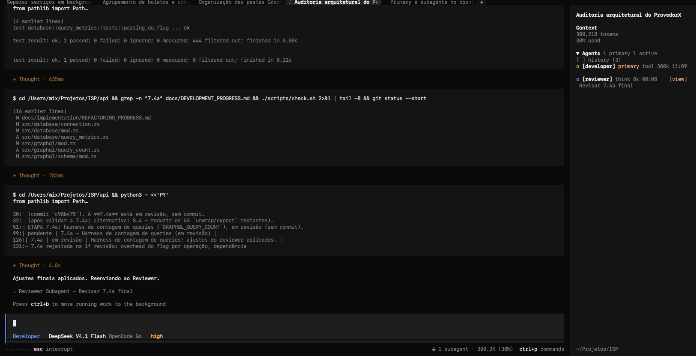
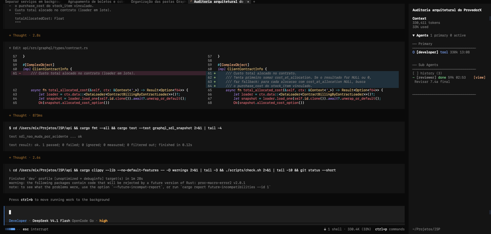

<p align="center">
  <picture>
    <source srcset="assets/logo-dark.svg" media="(prefers-color-scheme: dark)">
    <source srcset="assets/logo-light.svg" media="(prefers-color-scheme: light)">
    
  </picture>
</p>
<p align="center">Keep every OpenCode agent in sight.</p>
<p align="center">
  <a href="https://github.com/BlackMix/opencode-agents-monitor-sidebar-v3/blob/main/LICENSE"></a>
</p>
<p align="center">
  English | <a href="README.zh-CN.md">中文</a>
</p>

---

An [OpenCode](https://opencode.ai) TUI plugin that brings live agent progress straight into the session sidebar. See the session's primary agent alongside every sub-agent, which ones are still working, what each one is doing, and the elapsed time, context, and cost for each, all without leaving your main session.

Expand an agent for its model, current tool, and cost. When you need the full story, open the child session directly from the sidebar.

<p align="center">
  
</p>
<p align="center"><sub>Primary agent and live sub-agent progress</sub></p>

<p align="center">
  
</p>
<p align="center"><sub>Sub-agent done work</sub></p>

### Why use it?

Once a session fans out across several tasks, it becomes hard to tell what is still moving and what has already finished. The widget keeps that picture visible: active work updates in real time, the last completed run of each sub-agent stays listed with a dimmed marker, older runs move into an opt-in history section, and earlier child sessions reappear when the TUI starts.

### What you get

- **Primary agent included:** the session's main agent always appears above its sub-agents, marked `primary`
- **Every sub-agent, at any depth:** nested sub-agents are listed too, indented under their parent
- **Live progress at a glance:** distinguish `thinking`, `tool`, `retry`, `done`, and `idle` states as they change
- **The current tool, while it runs:** see a concise call such as `bash npm test` before it finishes
- **Useful numbers, not noise:** context, elapsed time, model, and cost for each agent
- **Idle agents stay visible:** when a sub-agent finishes it remains in the list with a dimmed `-` marker, so you always know what is idle instead of watching rows disappear
- **A tidy long-running session:** only the latest run of each sub-agent stays in the main list; older runs hide behind an opt-in `history` checkbox and are paginated when opened
- **Details on demand:** keep rows compact, expand the ones you care about, or use `[view]` to open the full child session; press `up` to return
- **History after a restart:** context and elapsed time for earlier agents are restored lazily from the API

### Compatibility

This fork targets the OpenCode v2 TUI plugin API (`@opencode/plugin@2`, `Plugin.define`) and OpenCode `2.0.0+`. It is tested with OpenCode `2.2.5`.

### Installation

#### From this repository

```bash
git clone https://github.com/BlackMix/opencode-agents-monitor-sidebar-v3.git
cd opencode-agents-monitor-sidebar-v3
bun install
bun run build
```

Point the global `~/.config/opencode/cli.json` at the checkout. In OpenCode v2, TUI plugins are configured only there; `tui.json` is no longer read.

```json
{
  "plugins": ["/absolute/path/to/opencode-agents-monitor-sidebar-v3"]
}
```

Reload the TUI (`/reload`). The widget appears in the session sidebar; press `ctrl+x`, then `b` if the sidebar is hidden.

#### From npm

Once the package is published:

```bash
opencode plugin add opencode-agents-monitor-sidebar-v3
```

### Usage

| Action | Result |
| --- | --- |
| Click the `Agents` header | Collapse or expand the entire widget (persists) |
| Click an agent row | Show or hide its model, current tool, and cost |
| Click `[view]` | Open the agent's complete child session |
| Click `[ ] history (n)` | Show or hide completed agents (persists) |
| Click `[<]` / `[>]` | Move through history pages |

Status markers breathe while an agent is active; `!` means retrying, and `-` means idle or done. State words are color-coded: `think` in purple, `tool` in blue, `done` in green. The primary row shows its state, context, and elapsed time without any `primary` label.

### How it works

- Uses the TUI's official `sidebar.content` slot, the same extension point as the built-in Context and Todo widgets. No host patching required.
- Resolves the root session and finds every descendant session (`parentID`) from `session.created`, `session.updated`, and `session.deleted` events, plus one initial `session.list()` call. The root is rendered as the `primary` row, and the sidebar stays anchored to it even while you view a child session.
- Combines `session.status` (`busy` / `retry` / `idle`) with the shared message store to show live state and the latest tool call.
- Fetches `session.messages` once for completed agents when needed, restoring context size and elapsed time for historical sessions.
- Keeps completed sessions out of the active list using their run state, `time.idle`, and `outcome`, so the same sub-agent does not appear twice.
- Keeps widget state outside the slot component tree, so slot re-renders do not reset your expanded and history preferences.

### Development

```bash
git clone https://github.com/BlackMix/opencode-agents-monitor-sidebar-v3.git
cd opencode-agents-monitor-sidebar-v3
bun install
bun run build
```

Point the global `~/.config/opencode/cli.json` at this checkout:

```json
{
  "plugins": ["/absolute/path/to/opencode-agents-monitor-sidebar-v3"]
}
```

For a local path, OpenCode v2 resolves the physical `tui.js` in the repository root, which re-exports the build output `dist/index.js`, so run `bun run build` after changing the source.

After changing the logo source, regenerate both variants with `node script/logo.mjs`.

### Publishing

The npm package must ship a compiled ESM entry. The host only applies its Solid JSX transform outside `node_modules`, so exporting raw `src/index.tsx` would cause the plugin to be skipped during loading.

```bash
bun install
bun run build # writes dist/index.js
npm publish
```

### Author

BlackMix · [mixchatmix3@gmail.com](mailto:mixchatmix3@gmail.com)

### License

MIT. See [LICENSE](LICENSE).
