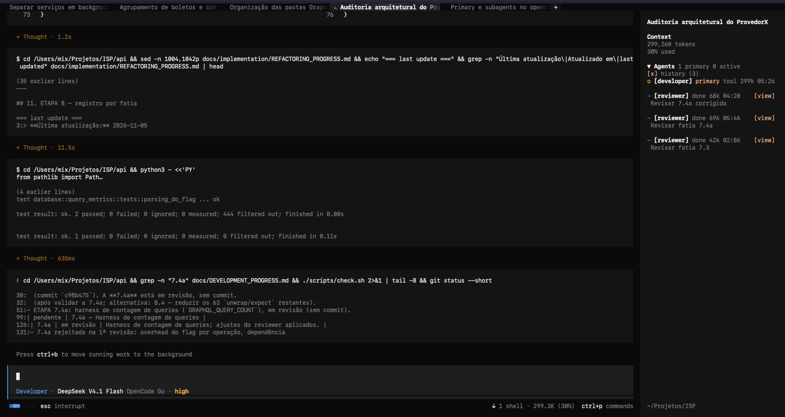
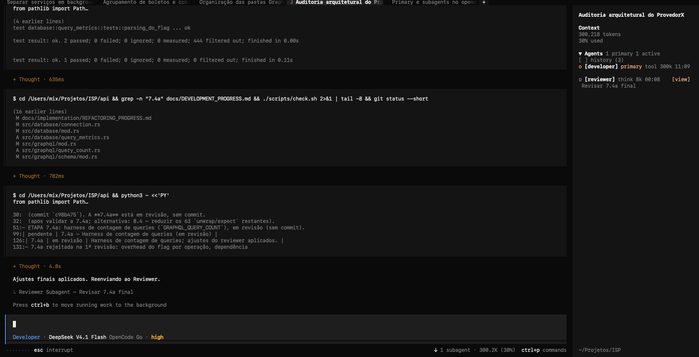

<p align="center">
  <picture>
    <source srcset="assets/logo-dark.svg" media="(prefers-color-scheme: dark)">
    <source srcset="assets/logo-light.svg" media="(prefers-color-scheme: light)">
    
  </picture>
</p>
<p align="center">让每个 OpenCode 代理的进度都清晰可见。</p>
<p align="center">
  <a href="https://github.com/BlackMix/opencode-agents-monitor-sidebar-v3/blob/main/LICENSE"></a>
</p>
<p align="center">
  <a href="README.md">English</a> | 中文
</p>

---

一个 [OpenCode](https://opencode.ai) TUI 插件，把代理的实时进度直接放进会话侧栏。会话的主代理会和所有子代理一起显示：哪些代理还在工作、各自在做什么，以及每个代理的耗时、上下文和费用，都能留在主会话中一目了然。

点击代理即可查看模型、当前工具和费用；真正需要完整细节时，再从侧栏直接进入对应的子会话。

<p align="center">
  
</p>
<p align="center"><sub>主代理与子代理的实时进度</sub></p>

<p align="center">
  
</p>
<p align="center"><sub>子代理完成的工作</sub></p>

### 为什么需要它？

当一个会话同时派出多个任务，很快就会难以分辨哪些仍在推进、哪些已经结束。这个组件会把整体进度留在侧栏：活动状态实时更新，每个子代理最近一次完成的运行仍以暗色标记留在列表中，较早的运行则进入可按需打开的历史区域，TUI 启动前已有的子会话也会重新显示。

### 你会得到

- **包含主代理：** 会话的主代理始终显示在子代理上方，并标记为 `primary`
- **任意层级的子代理：** 子代理再派生的代理也会按层级缩进显示
- **一眼看清实时进度：** 随状态变化区分 `thinking`、`tool`、`retry`、`done` 和 `idle`
- **工具还在运行时就能看到：** 在调用结束前显示 `bash npm test` 这样的简要信息
- **只展示真正有用的数据：** 每个代理的上下文、耗时、模型和费用
- **空闲代理仍然可见：** 子代理完成后会带着暗色 `-` 标记留在列表中，随时知道谁在空闲，而不是看着行消失
- **长会话也保持整洁：** 主列表只保留每个子代理最近一次运行，较早的记录默认隐藏，可通过 `history` 复选框按需显示并分页查看
- **一眼看到 Reviewer 结论：** 子代理以单独的 `REVIEW_STATUS:` 结论结束时，侧栏会在下方显示带颜色的 `review:` 行（`approved`、`rejected` 或 `blocked`）；通过时还会把 `NEXT_SLICE` 显示为蓝色的 `next:` 行
- **需要时查看拒绝原因：** review 为 `rejected` 时会出现 `[reason]` 按钮，打开可滚动的弹窗查看 `FINDINGS`、`REQUIRED_FIXES`、`DEVELOPER_INSTRUCTIONS` 和 `NEXT_SLICE`，用 `[x]` 或 `esc` 关闭
- **需要时再看细节：** 平时保持紧凑，点击展开关注的代理，或通过 `[view]` 打开完整子会话；按 `up` 即可返回
- **重启后仍有历史信息：** 通过 API 按需补齐已有代理的上下文与耗时

### 兼容性

本分支面向 OpenCode v2 TUI 插件 API（`@opencode/plugin@2`、`Plugin.define`）以及 OpenCode `2.0.0+`，并使用 OpenCode `2.2.5` 进行测试。

### 安装

#### 从本仓库安装

```bash
git clone https://github.com/BlackMix/opencode-agents-monitor-sidebar-v3.git
cd opencode-agents-monitor-sidebar-v3
bun install
bun run build
```

在全局 `~/.config/opencode/cli.json` 中指向本仓库目录。OpenCode v2 只在这里配置 TUI 插件，不再读取 `tui.json`：

```json
{
  "plugins": ["/absolute/path/to/opencode-agents-monitor-sidebar-v3"]
}
```

重新加载 TUI（`/reload`）。组件会出现在会话侧栏中；如果侧栏处于隐藏状态，先按 `ctrl+x`，再按 `b` 打开。

### 内置 Agents

安装包在 `agents/` 中附带两个 agent 定义：

- `developer.md` — 负责规划、实现、测试并协调 reviewer 的主代理
- `reviewer.md` — 只读子代理，用于审查计划、审计实现并选择下一个切片

npm 的 `postinstall` 钩子会把它们复制到 `~/.config/opencode/agents/`；使用本地路径安装时，则会在插件首次启动时复制。已存在的文件不会被覆盖，因此本地修改会在插件升级后保留。需要强制刷新时：

```bash
node script/install-agents.mjs --force
```

项目 `.opencode/agents/` 中的同名 agent 仍然优先于这些全局副本。

#### 从 npm 安装

包发布到 npm 后：

```bash
opencode plugin add opencode-agents-monitor-sidebar-v3
```

### 使用

| 操作 | 效果 |
| --- | --- |
| 点击 `Agents` 标题 | 折叠或展开整个组件（状态持久化） |
| 点击代理行 | 显示或隐藏模型、当前工具和费用 |
| 点击 `[view]` | 打开该代理的完整子会话 |
| 点击 `[ ] history (n)` | 显示或隐藏已完成的代理（状态持久化） |
| 点击 `[<]` / `[>]` | 翻页查看历史记录 |

代理活动时状态标记会循环变化；`!` 表示正在重试，`-` 表示空闲或已完成。状态词带有颜色：`think` 紫色、`tool` 蓝色、`done` 绿色。主代理行会显示状态、上下文和耗时，不再带 `primary` 标签。

### 工作原理

- 使用 TUI 官方的 `sidebar.content` 插槽，与内置 Context、Todo 组件共用同一扩展点，无需修改宿主代码
- 解析根会话，并通过 `session.created`、`session.updated`、`session.deleted` 事件以及一次初始 `session.list()` 调用，追踪由 `parentID` 关联的所有后代会话。根会话渲染为 `primary` 行；即使正在查看子会话，侧栏仍锚定在根会话上
- 结合 `session.status`（`busy` / `retry` / `idle`）和共享消息存储，显示实时状态与最近一次工具调用
- 在需要时为已完成的代理读取一次 `session.messages`，补齐历史会话的上下文与耗时
- 通过运行状态、`time.idle` 和 `outcome` 将已完成的会话移出活动列表，避免同一个子代理重复出现
- 扫描每个子代理最后一条助手消息，识别单独的 `REVIEW_STATUS: APPROVED|REJECTED|BLOCKED` 行并显示为带颜色的 `review:` 行；包含三个选项并用 `|` 分隔的模板行会被忽略。结论为 `APPROVED` 时，还会把 `NEXT_SLICE` 内容显示为蓝色的 `next:` 行；结论为 `REJECTED` 时，`[reason]` 会在弹窗中显示 findings 和 required fixes。主代理行不会显示任何 review 信息。
- 将组件状态保存在插槽组件树之外，因此插槽重渲染不会重置展开与历史偏好

### 开发

```bash
git clone https://github.com/BlackMix/opencode-agents-monitor-sidebar-v3.git
cd opencode-agents-monitor-sidebar-v3
bun install
bun run build
```

在全局 `~/.config/opencode/cli.json` 中指向本仓库目录：

```json
{
  "plugins": ["/absolute/path/to/opencode-agents-monitor-sidebar-v3"]
}
```

使用本地路径时，OpenCode v2 会解析仓库根目录下物理存在的 `tui.js`，它再导出构建产物 `dist/index.js`；因此修改源码后需要运行 `bun run build`。

修改 Logo 源码后，运行 `node script/logo.mjs` 重新生成亮色和暗色版本。

### 发布

发布到 npm 的包必须包含编译后的 ESM 入口。宿主只对 `node_modules` 之外的文件应用 Solid JSX 转换，因此直接导出原始 `src/index.tsx` 会导致插件在加载时被跳过。

```bash
bun install
bun run build # 生成 dist/index.js
npm publish
```

### 作者

BlackMix · [mixchatmix3@gmail.com](mailto:mixchatmix3@gmail.com)

### 许可证

MIT。详见 [LICENSE](LICENSE)。
